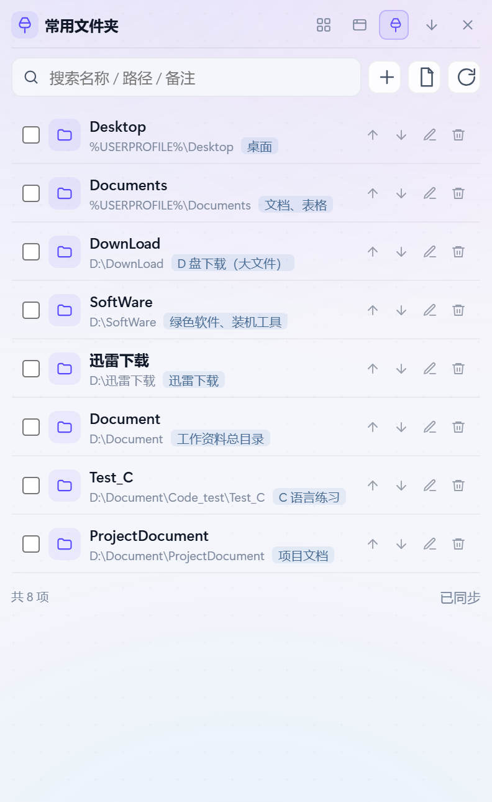
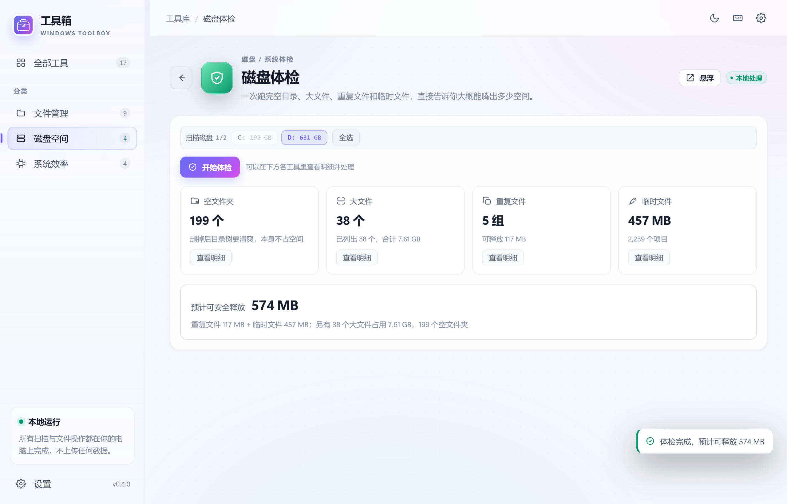
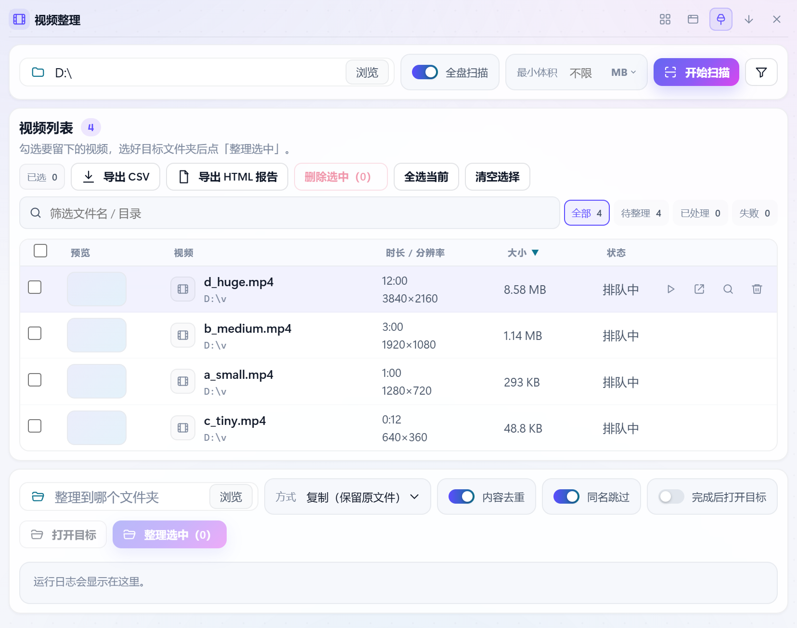

# 工具箱（Toolbox）

16 个本地小工具合成一个 exe：C++20 + Win32 + WebView2，界面 HTML/CSS/JS 全部内嵌，
不联网、不上传、不装依赖。v0.3 重做了视觉与悬浮窗：更轻的浅色界面、统一的描边图标、
更小的悬浮窗密度，并补齐快捷键帮助、半选、连带删除等细节。




## 直接运行

```
dist\Toolbox.exe
```

- 深链接：`Toolbox.exe --page tool=folders`、`--page tool=video-collector`
- 常驻：关闭按钮收进托盘；托盘单击开/收常用文件夹悬浮窗、双击开主窗口
- 唤出：`Ctrl+Alt+Shift+F` 开/收常用文件夹悬浮窗；开机自启以 `--startup` 静默进托盘
- 悬浮：托盘右键「悬浮工具」可开常用文件夹、剪贴板历史、快速搜索、视频整理，
  或「悬浮工具箱」打开 16 格启动面板；任意工具页右上角也有「悬浮」按钮
- 单实例：再次启动会激活已开的窗口
- 数据目录：`%LOCALAPPDATA%\Toolbox\`；在 exe 同目录放空的 `portable.ini` 则改用 `data\`

悬浮窗行为：

- 每个小窗是独立窗口 + 独立 WebView2 控制器，可拖动、缩放、四角吸附
- 默认尺寸更小：常用文件夹 318×432、剪贴板 356×438、快速搜索 552×452、
  视频整理 776×512、悬浮工具箱 452×528、其他 664×500（逻辑像素）
- 迷你顶栏一行放下：悬浮工具箱、打开主窗口、置顶、收起、关闭；
  收起后只剩标题条，双击标题栏展开
- 位置、尺寸、置顶、收起状态记在 `%LOCALAPPDATA%\Toolbox\mini-state.ini`
- 常用文件夹小窗内可直接搜索（命中高亮）、新增、编辑、删除、上移下移、多选批量删，
  不用回主页面；支持 Shift 连选、Ctrl+A、Insert/F2/Delete/Ctrl+F、数字键打开，
  以及右键菜单（打开/定位/复制路径/上移/下移/编辑/删除/打开清单/重新加载）
- 悬浮工具箱带搜索框，输入即过滤 16 个工具；设置页的「悬浮窗」卡片也能一键开窗

快捷键：`F1` 或顶栏键盘图标打开内置说明；`Ctrl+K` 搜索工具；
`Ctrl+Alt+Shift+F` 开/收常用文件夹悬浮窗。视频整理支持 `Ctrl+F / Ctrl+A /
Delete / Enter / Esc`，表头复选框支持半选。

命令行参数（脚本 / 快捷方式用）：

```
--page "tool=video-collector&vroot=D:\Videos&vdst=D:\Keep&vauto=1"
--panel                 启动后直接弹出常用文件夹悬浮窗
--startup / --minimized 静默启动到托盘（不显示主窗口）
--autostart=on|off      无窗口地开关开机自启（写 HKCU Run）
--quit                  让已运行的实例退出
```

## v0.3 改了什么

- 视觉：重建设计令牌与组件层（Aurora 浅色底、统一圆角/描边/阴影、卡片悬浮反馈、
  精简表头与滚动条），图标统一为 1.8px 描边 SVG，并新增窗口、帮助、筛选等图标。
- 悬浮窗：默认尺寸整体收紧，迷你顶栏补「打开主窗口」，设置页新增悬浮窗入口，
  悬浮工具箱支持搜索过滤。
- 功能：视频表头半选、删除时可连带目标副本、`F1` 快捷键说明；设置页「本地数据目录」
  改为真实数据目录；标题统一为「工具箱」。
- 修正：`Esc` 在悬浮窗里不再跳回首页；快速文件搜索页可用；视频设置可折叠。

## v0.5.2 改了什么（结果行直接跳转）

扫描类结果原来只有「复制路径」，还要自己去地址栏粘贴。现在每一行都带一个「在资源管理器中定位」按钮，点一下直接跳到该文件/文件夹所在目录并选中它。

覆盖范围：大文件扫描、重复文件、空文件夹、临时文件、磁盘空间分析、哈希校验、文件整理预览与结果、视频整理列表、快速搜索。

## v0.5.1 改了什么（跨设备显示一致）

同一份悬浮窗配置，换到另一台缩放不同的电脑上打开会变小、内容被挤成一行，或者下方多出一大片空白。原因是窗口尺寸按**主屏系统 DPI** 换算，而 WebView2 的内容是按**窗口所在显示器 DPI** 渲染的，两边倍率对不上。

- 尺寸统一按窗口所在显示器的 DPI 换算（`GetDpiForWindow`），不再用主屏的 `GetDpiForSystem`
- 悬浮窗位置与尺寸改成 96 DPI 基准的逻辑尺寸保存，换机器后视觉大小一致；旧配置自动兼容
- 工作区改取窗口所在显示器，副屏上开窗不再被主屏边界夹回来
- 宿主侧不再改动 WebView2 的缩放倍率：它默认自己跟踪显示器 DPI（`ShouldDetectMonitorScaleChanges`），重复设置会放大两次

100% / 125% / 150% / 200% 缩放下，同一份配置现在给出相同的视觉尺寸。

## v0.5 改了什么（工程地基 + 磁盘体检）

- **磁盘体检（新工具，第 17 个）**：一次跑完空文件夹、大文件、重复文件、临时文件，四张卡
  各给数量与体积，底部汇成一句「预计可安全释放」。四步严格串行——后端同一时间只跑一个主
  任务，上一步的 done 到了才发下一步，进度消息只改一行文本、不整页重绘。盘勾选直接复用
  大文件/重复/空文件夹那一份记忆；点「查看明细」跳到对应工具时自动带上同样的盘。
  实测只勾 D 盘：199 个空文件夹、38 个大文件占 7.61 GB、5 组重复可释放 117 MB、临时文件
  457 MB，合计可安全释放 574 MB，全程约 3 秒。

  

  
- **版本号只有一个来源**：工程根 `version.txt`（形如 `0.5.0`），`build.ps1` 生成 `version.h`
  与 `version_rc.h`，程序内版本、exe 属性、zip 文件名全从它来。侧栏那个版本号原先写死在
  `index.html`，现在改成由原生 `appInfo` 上报后填充，不会再出现「界面上是旧版本」。
- **前端拆块**：`web/app.js`（约 8000 行）拆成 `web/js/01-core.js … 09-checkup.js`，
  `build.ps1` 按文件名前缀顺序拼接后内联进 HTML——产物仍是单文件 exe，运行时不多发请求。
  改某个工具时只需要滚它所在的那一块。
- **扫描回归测试**：`tests/scan_tests.cpp` 造一棵临时目录树，断言空目录识别（含"只由空目录
  组成的父目录"）、大文件筛选与排序、重复文件归组（同大小不同内容不许归一组），20 条断言
  几秒跑完。`build.ps1 -Test` 一键执行，不打扰正在运行的 Toolbox。
- **盘符枚举独立成文件**：`FixedDriveRoots()` 挪到 `src/tools/drive_roots.cpp`，不再依赖命令
  总线，测试因此只需链三个实现文件，而不是把整套工具层拖进来。
- **工程进了 git**：`dist/`、`build/` 忽略，源码、文档、截图入库，每步改动可回退、可 diff。
  换行统一成 LF（`.gitattributes`），Windows 端不会再出现"全文件假 diff"。

## v0.4 补了什么（对照表里的遗留缺口）

- **扩展名勾选面板**：视频扫描设置里 24 个常见后缀可点选，手输任意后缀会变成额外
  标签（点掉即移除）；底层仍是同一个 `exts` 字符串，扫描行为没变。
- **文件夹右键补两项**：「隐藏悬浮窗」只收起面板、「退出工具箱」直接结束程序。
- **高度随条目数**：常用文件夹悬浮窗按内容测量后自动改高；你手动拖过高度后就不再
  自动改（`mini-state.ini` 里 `FitH=0`）。顺带修了窗口尺寸记成外框导致反复开关越来越大的问题。
- **任务栏开关**：设置页「在任务栏显示」，走 `ITaskbarList` 增删按钮，默认开启，
  关掉后只能从托盘或 `Ctrl+Alt+Shift+F` 唤出。
- **独立预览窗**：视频预览浮层多了「独立窗口」，单独开一个只放播放器的小窗，
  支持系统播放器回退；每次打开都是新窗口，不会残留上一部画面。
- **扫描后按内容分组**：扫描设置里可开；扫描完只对同体积文件读首/中/尾各 64KB，
  同指纹的标「同内容 n/N」，列表上方给出「每组保留一份」，不动任何文件。
- **悬浮窗能真的收起了**：点顶栏的 ↓ 收成一行（高 44，只剩图标、名称和窗口按钮），
  点 ↑ 或双击标题栏展开；折叠状态会记住，下次打开还是那条。
- **图标居中**：所有 `.icon-btn` 归零了浏览器给 button 的默认内边距（`1px 6px`），
  之前 13px 图标在 24px 按钮里被挤出 1.5px 的右偏。
- **卡片上直接悬浮**：工具卡右上角除图钉（置顶）外多了一个窗口图标按钮，点它就把该
  工具丢进悬浮窗，主窗口停在原处；已经在开着的窗口只会前置，不会像开关一样被关掉。
- **折叠态不再空白**：修了「上次折叠着关掉，再打开只有一条空白窗」——折叠条是网页画的，
  创建控制器时不能把 WebView 隐藏掉。
- **扩展名面板重新排过**：手输框不再是一条通栏大输入框，改成和 chip 同级的一枚虚线
  「＋ 添加格式」小胶囊，输入回车即变成 chip，逗号可一次输多个；同时 `.field` 里的
  input 统一去掉浏览器默认边框，不会再出现「框中框」那种一边黑一边灰的描边。
- **置顶现在真的会置顶**：图钉按钮此前没有处理函数（点了直接报错，界面毫无变化）。
  补上之后，点卡片右上角图钉，卡片会从原分类挪到首页顶部的「置顶」组，页面自动滚到
  该组并弹一条提示；置顶中的图钉变成紫底白钉、常驻可见，再点即取消并回到原分类。
  置顶状态写 `localStorage` 的 `toolsoft.pinned`，重启后保持。
- **图标重做**：exe 图标（`resources/app.ico`，16～256 共 10 个尺寸的 PNG 帧）与界面
  左上角品牌标识换成同一张图——紫靛渐变圆角方块 + 白色线条工具箱，配色跟界面 accent
  一致；托盘、任务栏、窗口图标取的都是 exe 资源 1 号图标，重建即生效。
  资源管理器里仍显示旧图标时属于系统图标缓存，`ie4uinit.exe -show` 或重启 explorer 即刷新。
- **两个卡片按钮分开**：置顶是图钉（紫），悬浮打开换成「弹出窗口」的箭头图标（青），
  两者图标形状、hover 配色、默认透明度都不同；工具页右上那个「悬浮」按钮原先误用了
  图钉，现在也统一成箭头图标。
- **体积阈值可自由填**：最小/最大体积不再是一串固定档位，改成「数字框 + KB/MB/GB 下拉」，
  数值可填小数（如 1.5 GB、200 KB）。覆盖大文件扫描、重复文件查找、快速搜索、视频整理的
  最小/最大体积，以及文件整理规则里原来的「最小 MB / 最大 MB」两栏。
- **悬浮窗不再先闪白壳**：窗口改为「首帧画好再出场」——等 WebView2 报 DOM 就绪（另有 500ms
  兜底，防止页面异常时点了没反应）才 `ShowWindow`，并把 WebView 默认底色设成界面同色
  `#F4F6FB`。点击到出场之间顺手给按钮加了呼吸态，避免"点了没反应"的错觉。
  冷开约 200ms、二次打开 30ms 以内。
- **启动和开窗快了近 2 秒**：`toolsoft.local` / `shots.local` / `media.local` 这三个虚拟主机名
  不是真实域名，Chromium 会先做一次 DNS 查询、失败后卡在 2 秒超时才回落到本地映射。
  现在启动时通过 `--host-resolver-rules` 把它们直接钉到 `127.0.0.1`，主窗口首屏从约 2.0 秒
  降到 50ms，悬浮窗冷开也从 370ms 降到 200ms（同时保留外部传入的调试参数）。
- **视频整理的运行日志能正常看了**：日志行原先复用了加载骨架的 `.line` 类（一条 5px 高、
  胶囊圆角的灰色占位条），于是每行日志都被压成一条灰带、文字只露半截。改成独立的
  `.vlog-line` 并给面板加了最小高度（主窗 58px、悬浮窗 44px / `flex: none` 防压扁），
  空态提示和 ok / warn / err 三种颜色都恢复正常。
- **悬浮工具箱不再"空着"打开**：它是 16 个工具的快捷面板，窗口状态文件里记着上次被收起的
  折叠状态（`Collapsed=1`），于是再打开时只剩一行标题条，看着像坏了。现在 launcher 不记忆
  收起状态，每次打开都直接铺开工具网格；其它工具窗仍按上次的位置/大小/折叠恢复。
- **列表可以点表头排序**：视频整理、临时文件清理、哈希校验、空文件夹四张表都支持点表头
  排序——同一列再点一次换方向，当前列标题后面跟 ▲/▼。数值列（大小、修改时间、时长）
  第一次点默认从大到小/从新到旧，文字列（名称、路径、状态）第一次点默认正序；体积按字节、
  时间按真实时间比较，文件名用 `zh-CN` 本地化比较（`2.mp4` 排在 `10.mp4` 前面）。视频表
  默认按大小降序，另外补了「修改时间」列（后端扫描时一并取 `ftLastWriteTime`）；排序后
  「显示更多」仍然接着从最前面往下取。临时清理和空文件夹是**原地重排**（行上的 `data-index`
  跟着一起走），勾选、单个删除不会错行。

  

  悬浮窗里视频表宽度不够，修改时间列在 mini 模式下隐藏（表头和单元格一起），其余列照旧
  可点排序。

  
- **悬浮窗里的长页面能滚了**：文件整理一屏放不下，但以前滚不动。原因有两层——`.view` 带着
  `flex: 1 1 0%`（flex-basis 优先于 `height`），mini 模式写的 `height: 100vh` 根本不起作用，
  内容把 `.view` 撑到 2121（窗口只有 869），溢出部分被 `body{overflow:hidden}` 裁掉；
  同时「高度跟随内容」的 `fitHeight` 会照着内容把窗口一路拉高，长表单页能把窗口顶出屏幕。
  现在 mini 模式整条高度链改成 flex（`.app` 列方向 → `.main` → `.view` 三段都带
  `min-height: 0`），`.view` 拿到确定高度后自己滚；`fitHeight` 也加了上限（内容超过可用桌面
  高度时只报上限，多出来的交给滚动）。

  
- **「全盘扫描」能挑盘了**：以前这个开关只是"忽略上面的路径、扫所有本地磁盘"，扫哪几块由
  程序决定，用户看不出区别。现在勾上开关，路径框会换成磁盘勾选条——每块盘显示盘符和可用
  空间（如 `C: 193 GB` / `D: 631 GB`），默认全选，点一下就取消/恢复某块盘，右边按钮在
  「全选 / 全不选」之间切换；一块都没选时点「开始扫描」会提示先勾一块盘。扫描进行中的文案
  也会写出具体盘符（"正在扫描 C:、D:，大目录会比较慢…"）。后端 `video.scan` 新增 `drives`
  参数，只扫选中的盘；`video.drives` 负责把盘符、卷标、容量报给界面。选中的盘记在
  `localStorage` 里，下次打开保持。

  

  悬浮窗里盘符条独占一行，开关和「开始扫描」落到下一行。

  
- **同一套选盘也扩到了另外三个工具**：大文件扫描、重复文件查找、空文件夹清理的工具栏都
  多了「全盘扫描」开关，打开后路径框换成同样的盘符条（共用一份勾选，三处保持一致）。后端
  扫描器改成接受「多根目录」——`scanLarge` / `scanEmpty` / `scanDuplicates` 都能收 `roots`
  数组，传空数组就是全部固定磁盘；重复文件查找还会把不同盘上的同内容文件归到同一组。盘符
  枚举统一到新模块 `src/tools/drives.*`（只算固定磁盘，U 盘不再混进全盘扫描，也不会出现
  "盘符条里看不到但实际被扫"的情况）。

  

  空文件夹清理与重复文件查找是同一个盘符条：

  

  

  悬浮窗里盘符条同样独占一行：

  
- **修掉一个会让全盘扫描假死的问题**：扫描器每结束一个目录就强制发一条进度，盘里有十万级
  目录时会瞬间灌出上万条 `PostWebMessage`，WebView2 的消息队列被塞满，界面表现为进度停住、
  「取消」点了没反应、扫描结束的 `scanDone` 也排不上队，后续再点扫描同样毫无反应。现在所有
  进度都走 120ms 节流（实测 D 盘全盘 13 万文件/1 万目录，进度消息从 1 万条降到 6 条，0.7 秒
  出结果）。

## 构建

需要本机已有 MSYS2（默认 `D:\SoftWare\msys64`，另有 WebView2 Runtime）。

```powershell
cd D:\Document\Code_test\all\toolbox
pwsh -NoProfile -ExecutionPolicy Bypass -File .\build.ps1
```

产物：`dist\Toolbox.exe`（约 5 MB，单文件）与同名 zip。
换 MSYS2 路径时改 `build.ps1` 顶部的 `$gxx` / `$windres`。

改完扫描/重复查找的代码，先跑一遍回归测试再打包：

```powershell
pwsh -NoProfile -ExecutionPolicy Bypass -File .\build.ps1 -Test
```

版本号只改 `version.txt` 一处（形如 `0.5.0`），构建时自动生成 `version.h` 与 `version_rc.h`，
程序内版本、exe 属性、zip 文件名都会同步。

## 目录速览

```
src/app.cpp                 外壳：窗口、WebView2、托盘/热键/自启、命令分发
src/mini_window.cpp         通用悬浮窗（置顶/收起/吸附/状态记忆）
src/media_handler.cpp       media.local 的 Range 文件服务（视频预览）
src/bridge.*                命令总线：{"id","cmd","args"} → {"type":"response","ok","data"}
src/tools/tool_folders.cpp  常用文件夹
src/tools/tool_video.cpp    视频整理命令层（缩略图/时长/预览/撤销）
src/tools/video/            视频扫描/去重/复制引擎
src/tools/drives.*          磁盘枚举：fs.drives 命令、全盘扫描的根目录集合
src/tools/drive_roots.cpp   只做"哪些盘算固定盘"的枚举（给扫描器和测试用）
web/js/*.js                 工具清单、页面、消息分发（按 01..08 前缀顺序拼接）
tests/scan_tests.cpp        扫描/空目录/重复查找的回归断言（build.ps1 -Test）
docs/技术路线.md            路线选择、扩展方式、加新工具四步
docs/功能对照.md            三套原版与本版的逐项差异
```

## 加一个工具

1. 新命令模块：`Bridge::Get().Add("xxx.yyy", handler)`，在 `bridge.cpp` 的
   `RegisterAllCommands()` 注册。
2. `web/js/` 里找个合适的块（`01-core.js` 放基础设施、扫描类看 `04-scan-pages.js`），
   把 `TOOLS` 加一条、`renderToolPageBody()` 加一个分支，页面里用
   `toolCall('xxx.yyy', args)` 调后端。文件名前缀决定拼接顺序，新增块请按前缀插到
   正确位置，别用 `99-` 之外的新前缀乱序。
3. 页面照常用 `pageHead()`，会自动获得「悬浮」按钮；托盘「悬浮工具箱」也会自动收录。
4. 重新构建，仍然是单个 exe。

长任务用 `tb::PostMessage()` 从工作线程推进度，消息类型自己加前缀，别和
`scanProgress / largeScanDone` 这类老消息同名。

## 工具清单

磁盘体检：一次跑完空文件夹、大文件、重复文件、临时文件，给出「预计可安全释放」的总账，
每项都能跳到对应工具看明细并处理（见 `docs/screenshots/checkup-result.png`）。

文件/磁盘：常用文件夹、视频整理（缩略图 + 时长/分辨率 + 内置预览 + CSV/HTML 报告）、大文件扫描、
空文件夹清理、重复文件查找、磁盘空间分析、批量重命名、文件哈希校验、快速文件搜索、
文件夹对比同步、文件整理。

系统：临时文件清理、文件占用解锁、剪贴板历史、U盘安全弹出、截图工具。

视频整理的源目录、目标目录、体积/格式、复制/移动、重名策略、开关都保存在
`localStorage`（键 `toolbox.videoSettings`），重开窗口后自动恢复。
